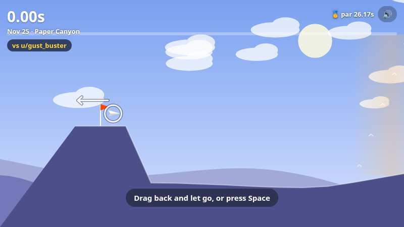

# Updraft

**A daily race needs a course everyone can play and a time everyone can trust.**



Updraft is a paper-plane race inside Reddit. Ride thermals, hit boost rings, and
race your best ghost or the fastest pilots on the day's course.

[Open the submitted race on Reddit](https://www.reddit.com/r/updraft_daily_dev/comments/1y1itqc/updraft_nov_21_lucky_ridge_starlit_saturday/) ·
[Demo subreddit](https://www.reddit.com/r/updraft_daily_dev/) ·
[Original Reddit demo](https://youtu.be/KKe-zw4jUCc) ·
[Local Devvit walkthrough](https://youtu.be/-eHnO1w_3ok) ·
[Devpost](https://devpost.com/software/updraft-vjakg5)

## How to play

1. [Open the submitted Nov 21 race](https://www.reddit.com/r/updraft_daily_dev/comments/1y1itqc/updraft_nov_21_lucky_ridge_starlit_saturday/) and choose **Throw** or **Chase**. For newer courses, use [the demo subreddit](https://www.reddit.com/r/updraft_daily_dev/).
2. Tap to launch, or drag back from the plane and release to aim your throw. Hold to climb and release to glide. Space and Up Arrow also launch and climb.
3. Use thermals for lift and boost rings for speed. Avoid balloons and fly through the finish gate to set a time.

You can fly as a guest. Sign in to save your time and ghost. See the [mobile judge check](docs/development.md#mobile-judge-check) for the expected guest flow and the evidence still needed on Reddit.
Your finish time appears immediately. The leaderboard waits for the server to replay your flight.
After your run, check the splits to see where you gained or lost time. Race your personal best, the par pilot, or a pilot from the leaderboard next.

## How it uses Devvit

Devvit Web puts the race inside a Reddit post. A scheduled job posts the daily
course, and Devvit Redis stores times, ghosts, and streaks. The server replays the
same flight inputs before recording a leaderboard time.

## Quickstart

From a fresh clone with Node 24 or newer:

```sh
npm ci && npm run preview
```

Open http://localhost:5180 for a local race with seeded ghosts.

[Devvit app listing](https://developers.reddit.com/apps/updraft-daily) ·
[Development](docs/development.md) · [BSD 3-Clause](LICENSE)
